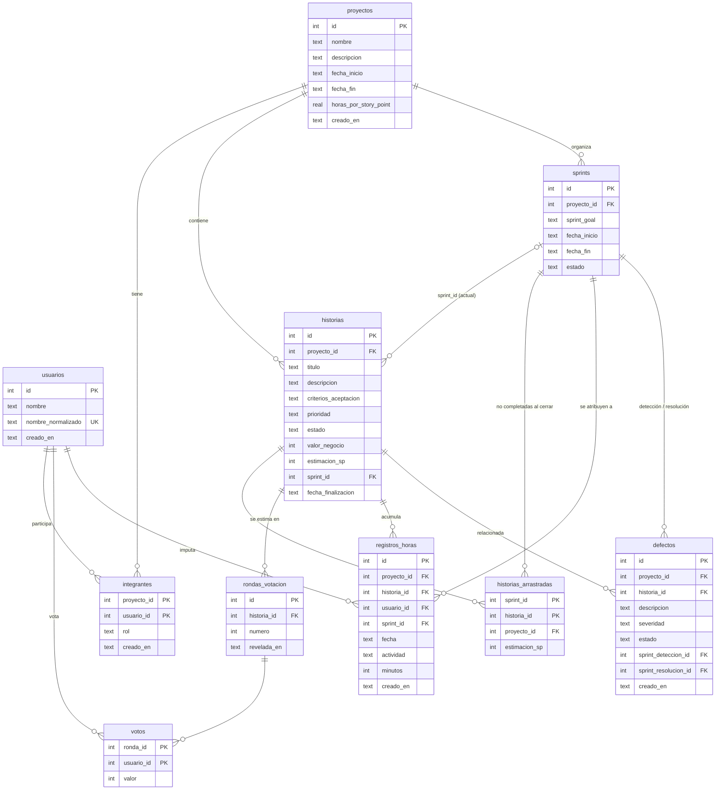

# Modelo de datos

Documento de diseño de la base SQLite. **Es la referencia única** para quien
implemente una historia: antes de escribir SQL, un repositorio o una migración,
se lee esto. Si una spec de `specs/` contradice este documento, se corrige uno
de los dos en el mismo PR; no se resuelve en el código.

- Estado: **definido** (2026-10-13): todas las decisiones de §7 están cerradas y entra en vigencia al mergearse el PR #116 (diseño inicial del 2026-10-09). Incorpora un
  análisis tipo `/speckit.analyze` y una revisión posterior. Todo el SQL de este documento
  se probó con filas válidas, inválidas y con `NULL` en SQLite 3.53.4, tanto con el módulo
  `sqlite3` de Python como con `modernc.org/sqlite` v1.60.1 (misma versión del motor).
  Va por PR en la rama `docs/modelo-de-datos`.
- Una decisión abierta se marca **PENDIENTE** (producto o profesor) y nadie la implementa
  hasta que se confirme (ver §7). Hoy no queda ninguna.
- Base: backlog refinado de `docs/PRODUCT-BACKLOG.md` (PR #105, 15 historias).
- Alcance: tablas, columnas, restricciones, migraciones y dónde vive cada regla.
  No incluye código.

## 1. Por qué existe

Los defectos del Sprint 1 que tocan la base salieron de lo mismo: cada historia
creó sus tablas por su cuenta.

| Síntoma | Causa en el esquema actual |
|---|---|
| #19: una historia o Sprint con `proyecto_id` inexistente se guardaba | `backlog_items` y `sprints` se crearon sin `FOREIGN KEY`; solo `project_members` la tenía |
| Nombres mezclados | `backlog_items`/`sprints` en español (`proyecto_id`, `estado`); `projects`/`users`/`project_members` en inglés (`name`, `start_date`, `role`) |
| Cada cambio pide "borrá `seguimiento.db`" | `CREATE TABLE IF NOT EXISTS` no modifica tablas existentes; los agregados se hacen con `ALTER` sueltos (`asegurarColumna`) |
| Fechas con dos formatos | Fechas del proyecto en RFC 3339, las del Sprint en `YYYY-MM-DD` |
| Reglas del backlog que la base no puede hacer cumplir | "un solo Sprint Activo", "fin posterior a inicio", "En progreso solo dentro de un Sprint" viven solo en el código |
| Datos que las historias futuras necesitan y hoy no existen | criterios de aceptación (HU-15), horas por Story Point (HU-03), fecha de finalización (HU-11), rondas y votos (HU-02/14), horas (HU-07), defectos (HU-08) |

Además hay un hueco de diseño que ninguna historia nota por separado: ver
[§7, D2a–D2c](#7-decisiones-pendientes-e-inconsistencias-del-backlog).

## 2. Convenciones (valen para todas las tablas)

| Tema | Regla |
|---|---|
| Idioma | Tablas y columnas en **español**, `snake_case`, tablas en plural. Los valores de los enums son los del dominio, tal cual (`Nueva`, `En progreso`, `M`, `scrum_master`); no se traducen ni se renombran. |
| Identificadores | `id INTEGER PRIMARY KEY AUTOINCREMENT` (int64). Toda referencia se llama `<entidad>_id`; si hay dos a la misma tabla, `<rol>_<entidad>_id` (`sprint_deteccion_id`). |
| Fechas de calendario | `TEXT` `YYYY-MM-DD` (`time.DateOnly`). Aplica a `fecha_inicio`, `fecha_fin`, `fecha` y `fecha_finalizacion`. |
| Instantes | `TEXT` RFC 3339 en UTC, columna `creado_en` (nunca `created_at`). Solo auditoría; no se usa en reglas de negocio. |
| Obligatoriedad | Se declara `NOT NULL` todo lo que el dominio exige siempre. `NULL` significa "todavía no definido", nunca "cero" ni "vacío". |
| Borrado | Ninguna historia borra datos. **Sin `ON DELETE CASCADE`**: se deja el comportamiento por defecto de SQLite, `NO ACTION`, que rechaza borrar (o cambiar el id de) un padre con hijos con `SQLITE_CONSTRAINT_FOREIGNKEY`. **No** se declara `ON DELETE RESTRICT`: rechaza igual pero con otro código (`SQLITE_CONSTRAINT_TRIGGER`), y rompería la traducción de errores de §5. Si algún día hace falta borrar, es una historia nueva con su propia decisión. |
| Claves foráneas | `PRAGMA foreign_keys = ON` en cada conexión (ya lo hace `AbrirSQLite`). Un test de repositorio por FK debe probarlo contra SQLite real, no contra un fake. |
| Enums cerrados | `CHECK (col IN (...))` para estados, roles, severidad y prioridad. Es la última barrera contra datos inválidos; la validación con mensaje sigue siendo del dominio. |
| Formato de fechas | `CHECK (date(col) IS col)` en **toda** columna de fecha de calendario (D12): rechaza `'2026-10-9'`, `'basura'` y `'2026-02-30'` y acepta `NULL`. Debe ser `IS`, no `=`. |
| Tipo de las columnas numéricas con un rango | Toda columna numérica con un `CHECK` de rango lleva también `typeof(col)`: en SQLite, `INTEGER` no impide guardar `1.5` ni `'abc'` (la afinidad solo convierte lo que puede) y `'abc' > 0` es verdadero, así que `CHECK (col > 0)` no alcanza (verificado en Python y en `modernc`). Se escribe `typeof(col) = 'integer'` para enteros y `typeof(col) IN ('real','integer')` para decimales. Los números validados por el dominio (D11) no lo llevan. |
| Escala Fibonacci | **Sin `CHECK`** en `valor_negocio`, `estimacion_sp` ni `votos.valor`: la escala vive solo en el dominio (DRY, D11). |
| Largos de texto | **No** van en la base (`titulo` ≤ 200, etc.): viven en el dominio y duplicarlos rompe DRY. |
| Qué NO se guarda | Estado del proyecto (HU-13) y métricas (HU-03): se calculan al consultar. Ver [§6](#6-qué-no-se-guarda-y-de-dónde-se-calcula). |

## 3. Diagrama

## 4. Tablas

Notación: **PK** clave primaria, **UK** única, **FK** clave foránea, `?` admite `NULL`.
"Existe hoy" indica si ya está en `main` (con otro nombre si corresponde).

### 4.1 `proyectos` — HU-04, HU-13, HU-03 (existe hoy como `projects`)

| Columna | Tipo | Notas |
|---|---|---|
| `id` | PK | |
| `nombre` | TEXT NOT NULL | |
| `descripcion` | TEXT NOT NULL DEFAULT `''` | |
| `fecha_inicio` | TEXT? | `YYYY-MM-DD` |
| `fecha_fin` | TEXT? | `YYYY-MM-DD` |
| `horas_por_story_point` | REAL? | **Nueva.** HU-03 Esc. 3. `NULL` = no definido → horas estimadas y desviación se informan "sin datos". |
| `creado_en` | TEXT NOT NULL | |

Restricciones de base:
- `CHECK (horas_por_story_point IS NULL OR (typeof(horas_por_story_point) IN ('real','integer') AND horas_por_story_point > 0))` — sin el `typeof`, `'abc'` pasaba (ver §2).
- `CHECK (date(fecha_inicio) IS fecha_inicio)` y `CHECK (date(fecha_fin) IS fecha_fin)` (D12)
- `CHECK (fecha_inicio IS NULL OR fecha_fin IS NULL OR fecha_fin > fecha_inicio)` — fin **estrictamente** posterior (#100). Los bordes inclusivos de HU-13 son una regla de *consulta*, no de almacenamiento.

### 4.2 `usuarios` — HU-04 (existe hoy como `users`)

| Columna | Tipo | Notas |
|---|---|---|
| `id` | PK | |
| `nombre` | TEXT NOT NULL | |
| `nombre_normalizado` | TEXT NOT NULL **UK** | minúsculas y sin espacios externos; es la identidad del usuario |
| `creado_en` | TEXT NOT NULL | |

Un usuario puede pertenecer a varios proyectos y puede existir sin ninguno.

### 4.3 `integrantes` — HU-04 (existe hoy como `project_members`)

| Columna | Tipo | Notas |
|---|---|---|
| `proyecto_id` | FK → `proyectos(id)` | PK compuesta con `usuario_id` |
| `usuario_id` | FK → `usuarios(id)` | |
| `rol` | TEXT NOT NULL | `CHECK IN ('scrum_master','product_builder')` |
| `creado_en` | TEXT NOT NULL | |

Un usuario tiene **un** rol por proyecto (lo garantiza la PK). Hoy no se impone un único Scrum Master por proyecto (ver D4).

### 4.4 `historias` — HU-01, HU-15, HU-06, HU-11, HU-14 (existe hoy como `backlog_items`)

| Columna | Tipo | Notas |
|---|---|---|
| `id` | PK | |
| `proyecto_id` | FK → `proyectos(id)` NOT NULL | Cierra #19. |
| `titulo` | TEXT NOT NULL | |
| `descripcion` | TEXT NOT NULL | |
| `criterios_aceptacion` | TEXT? | **Nueva.** HU-15. Texto libre en una sola columna (D10). `NULL` = sin criterios. |
| `prioridad` | TEXT NOT NULL | `CHECK IN ('M','S','C','W')` |
| `estado` | TEXT NOT NULL | `CHECK IN ('Nueva','En progreso','Completada')` |
| `valor_negocio` | INTEGER? | Escala Fibonacci `{1,2,3,5,8,13,21}`, validada por el dominio |
| `estimacion_sp` | INTEGER? | Story Points, misma escala. Los escriben HU-15 (directo) y HU-14 (acordada). `NULL` = sin estimar. **Decidido (D2b, 2026-10-13):** no se edita si la historia tiene un Sprint `Activo` o `Finalizado` (regla de servicio, §5). |
| `sprint_id` | INTEGER? | `NULL` = está en el Product Backlog. Si no, el Sprint **actual o en el que se completó**. |
| `fecha_finalizacion` | TEXT? | **Nueva.** HU-11. `CHECK (date(fecha_finalizacion) IS fecha_finalizacion)` (D12) |

Restricciones de base:
- `FOREIGN KEY (sprint_id, proyecto_id) REFERENCES sprints (id, proyecto_id)` — una historia **no puede entrar a un Sprint de otro proyecto**. Con `sprint_id NULL` SQLite no evalúa la FK (comportamiento `MATCH SIMPLE`), que es lo que se quiere.
- `UNIQUE (id, proyecto_id)` — necesaria para que otras tablas la referencien de la misma forma.
- `CHECK (estado = 'Nueva' OR sprint_id IS NOT NULL)` — "`En progreso` y `Completada` solo existen dentro de un Sprint" (decisión transversal).
- `CHECK ((estado = 'Completada') = (fecha_finalizacion IS NOT NULL))` — la fecha existe si y solo si está completada.

Orden del Product Backlog (HU-15): `sprint_id IS NULL`, por prioridad `M, S, C, W` y luego `id`. El orden alfabético de `prioridad` **no** sirve (`C` < `M` < `S` < `W`): se ordena con un `CASE` explícito. El "orden de creación" es `id`; por eso no hace falta `creado_en`.

### 4.5 `sprints` — HU-05 (existe hoy, mismo nombre)

| Columna | Tipo | Notas |
|---|---|---|
| `id` | PK | |
| `proyecto_id` | FK → `proyectos(id)` NOT NULL | Cierra #19. |
| `sprint_goal` | TEXT? | `NULL` mientras está `Pendiente` |
| `fecha_inicio` | TEXT? | idem |
| `fecha_fin` | TEXT? | idem |
| `estado` | TEXT NOT NULL | `CHECK IN ('Pendiente','Activo','Finalizado')` |

Restricciones de base:
- `UNIQUE (id, proyecto_id)` (para las FK compuestas de otras tablas).
- Pendiente ⇒ goal y fechas en `NULL`; Activo/Finalizado ⇒ goal y **las dos** fechas presentes y `fecha_fin > fecha_inicio`:
  `CHECK ((estado = 'Pendiente' AND sprint_goal IS NULL AND fecha_inicio IS NULL AND fecha_fin IS NULL) OR (estado <> 'Pendiente' AND sprint_goal IS NOT NULL AND fecha_inicio IS NOT NULL AND fecha_fin IS NOT NULL AND fecha_fin > fecha_inicio))`
  El `fecha_fin IS NOT NULL` es imprescindible: sin él, un Sprint `Activo` con `fecha_fin NULL` **entraba** (la comparación da `NULL` y un `CHECK` que da `NULL` no falla; verificado). Ver §4.10.
- `CHECK (date(fecha_inicio) IS fecha_inicio)` y `CHECK (date(fecha_fin) IS fecha_fin)` (D12).
- Un solo Activo y un solo Pendiente por proyecto, como **índices únicos parciales**:
  `CREATE UNIQUE INDEX sprints_un_activo_por_proyecto ON sprints (proyecto_id) WHERE estado = 'Activo'` y
  `CREATE UNIQUE INDEX sprints_un_pendiente_por_proyecto ON sprints (proyecto_id) WHERE estado = 'Pendiente'`.
  Hoy esa regla vive solo en el servicio y el PR #17 ya registró el límite (dos pedidos simultáneos podrían violarla).

### 4.6 `historias_arrastradas` — HU-05 cierre, HU-09, HU-10, HU-12 (**tabla nueva**, migración 002)

Resuelve el hueco D2a. Al cerrar un Sprint, las historias no completadas se quedan
sin `sprint_id` (HU-05 Esc. 2), así que **después del cierre ya no se sabe qué se
había comprometido**. Sin ese dato no se pueden calcular "Story Points
planificados", el gráfico "comprometidos vs. completados" (HU-09) ni el detalle de
un Sprint pasado (HU-12). Esta tabla registra cuáles quedaron afuera.

| Columna | Tipo | Notas |
|---|---|---|
| `sprint_id` | INTEGER NOT NULL | PK compuesta con `historia_id`. FK compuesta `(sprint_id, proyecto_id)` → `sprints(id, proyecto_id)`. |
| `historia_id` | INTEGER NOT NULL | FK compuesta `(historia_id, proyecto_id)` → `historias(id, proyecto_id)`. |
| `proyecto_id` | INTEGER NOT NULL | Redundante a propósito: sostiene las dos FK compuestas (igual que en `registros_horas` y `defectos`). |
| `estimacion_sp` | INTEGER? | Foto de `historias.estimacion_sp` al cerrar. `NULL` si no estaba estimada. Nunca se actualiza: la historia vuelve al Product Backlog, donde HU-15 sí puede editarla, y los SP planificados del Sprint viejo no deben cambiar. |

**Por qué lleva `proyecto_id` con FK compuestas.** El principio "la base garantiza que todo es del mismo proyecto" ya rige en `historias`, `registros_horas` y `defectos`; esta tabla era la excepción. Se probó la alternativa sin `proyecto_id` (dos FK simples a `sprints(id)` e `historias(id)`): **acepta** una fila con el Sprint del proyecto 1 y la historia del proyecto 2. Con `proyecto_id` y FK compuestas, esa fila se rechaza con cualquiera de los dos valores de `proyecto_id`. El costo es una columna y una FK más, y la PK no cambia; la escribe un único método (`CerrarConArrastre`), que ya conoce el proyecto del Sprint. Lo que la base **no** puede garantizar es que la historia *estuvo* en ese Sprint: eso es responsabilidad de `CerrarConArrastre` y de su test.

- Una historia puede estar en varios Sprints si se arrastra más de una vez.
- Historias **comprometidas** de un Sprint = `historias WHERE sprint_id = S` (las completadas) ∪ `historias_arrastradas WHERE sprint_id = S`. **Decidido (D2c, 2026-10-13):** "comprometidas" significa *lo asignado al cerrar el Sprint* (incluidas las historias agregadas con el Sprint ya `Activo`). Es una definición de producto que afecta HU-03, 09, 10 y 12 y ya figura en el backlog.
- SP **planificados** de S = `SUM(historias.estimacion_sp)` de las completadas + `SUM(historias_arrastradas.estimacion_sp)`. Las completadas no necesitan foto **porque D2b está aprobada** (no se edita `estimacion_sp` con Sprint `Activo`/`Finalizado`).

**Cómo se escribe: una sola operación de repositorio.** El cierre no son tres llamadas sueltas (hoy `CerrarSprint` llama a `QuitarDeSprint` historia por historia y después a `Actualizar`, sin transacción):

1. El caso de uso carga las historias del Sprint y las separa en completadas y no completadas.
2. Llama a `sprint.Cerrar()` del dominio, que valida que esté `Activo`.
3. Entrega al repositorio el Sprint cerrado y las no completadas en **una sola llamada** nueva de `SprintRepository`: `CerrarConArrastre(ctx, sprint, noCompletadas)`.
4. El adaptador SQLite, en **una transacción**: `UPDATE sprints` a `Finalizado`; `INSERT` en `historias_arrastradas` (con `proyecto_id` y la foto de SP); y `UPDATE historias SET sprint_id = NULL, estado = 'Nueva'` **en un solo `UPDATE`**.

Sobre el `UPDATE` único (verificado): hacerlo en dos pasos falla **solo si primero se quita el Sprint** de una historia que sigue `En progreso` (el `CHECK` de §4.4 exige Sprint para ese estado). Si primero se vuelve a `Nueva`, o si la historia ya estaba `Nueva`, los dos pasos pasan. El `UPDATE` único sigue siendo lo más simple y robusto porque **no depende del orden** de las sentencias.

La transacción es un detalle de SQLite, así que no entra al dominio ni al servicio (arquitectura hexagonal). El fake en memoria debe simular la atomicidad: un fake que no la tiene oculta defectos (punto 2 de #101).

### 4.7 `rondas_votacion` y `votos` — HU-02, HU-14 (**tablas nuevas**, migración 003)

El backlog exige modelar rondas desde HU-02 (cada voto pertenece a una ronda) para
que HU-14 no tenga que reestructurar.

`rondas_votacion`

| Columna | Tipo | Notas |
|---|---|---|
| `id` | PK | |
| `historia_id` | FK → `historias(id)` NOT NULL | |
| `numero` | INTEGER NOT NULL | 1, 2, 3… por historia. `UNIQUE (historia_id, numero)`. |
| `revelada_en` | TEXT? | RFC 3339. `NULL` = votos ocultos. Es lo que HU-14 Esc. 4 consulta ("la votación fue revelada"). |

`votos`

| Columna | Tipo | Notas |
|---|---|---|
| `ronda_id` | FK → `rondas_votacion(id)` | PK compuesta con `usuario_id`: un voto por integrante y ronda. |
| `usuario_id` | FK → `usuarios(id)` | |
| `valor` | INTEGER NOT NULL | La baraja es la misma escala Fibonacci que `estimacion_sp`, validada por el dominio. |

- **Ronda actual** de una historia = la de mayor `numero`. Las anteriores son el historial (HU-14 Esc. 2); no se borra nada.
- La **estimación acordada** no tiene tabla: se escribe en `historias.estimacion_sp` (HU-14 Esc. 3).
- Ocultamiento: mientras `revelada_en IS NULL` la API **no devuelve** los valores, solo quién votó. Esa regla es del servicio/handler, no de la base.
- Que el votante sea integrante del proyecto lo valida **solo el servicio**, a propósito: la base no puede hacerlo sin repetir `proyecto_id` en `rondas_votacion` y `votos`, y no se justifica (a diferencia de `registros_horas` y `defectos`, que ya lo llevan).

### 4.8 `registros_horas` — HU-07 (**tabla nueva**, migración 004)

| Columna | Tipo | Notas |
|---|---|---|
| `id` | PK | |
| `proyecto_id` | NOT NULL | redundante a propósito, sostiene las FK compuestas |
| `historia_id` | NOT NULL | |
| `usuario_id` | NOT NULL | quién trabajó |
| `sprint_id` | NOT NULL | Sprint **activo en el momento de la carga** (HU-07 Esc. 1). No se recalcula nunca, aunque la historia cambie de Sprint. |
| `fecha` | TEXT NOT NULL | día trabajado. `CHECK (date(fecha) IS fecha)` (D12) |
| `actividad` | TEXT NOT NULL | no vacía (validación del dominio) |
| `minutos` | INTEGER NOT NULL | `CHECK (typeof(minutos) = 'integer' AND minutos > 0)`. **Decidido (D8, 2026-10-13):** minutos enteros, no `horas REAL`; se convierten a horas solo al mostrar (ver §7). El `typeof` es necesario: con solo `minutos > 0`, `INTEGER` aceptaba `1.5` y `'abc'` (ver §2). |
| `creado_en` | TEXT NOT NULL | |

FK compuestas (todas incluyen `proyecto_id`):
`(historia_id, proyecto_id) → historias(id, proyecto_id)`,
`(sprint_id, proyecto_id) → sprints(id, proyecto_id)`,
`(proyecto_id, usuario_id) → integrantes(proyecto_id, usuario_id)`.
Con eso la base garantiza que el integrante, la historia y el Sprint son **del mismo proyecto**.

Esfuerzo real de una historia = `SUM(minutos)`; de un Sprint = `SUM(minutos) WHERE sprint_id = S` (en minutos; se muestra en horas).

### 4.9 `defectos` — HU-08 (**tabla nueva**, migración 005)

| Columna | Tipo | Notas |
|---|---|---|
| `id` | PK | |
| `proyecto_id` | NOT NULL | redundante a propósito |
| `historia_id` | NOT NULL | historia relacionada, obligatoria (HU-08 refinada) |
| `descripcion` | TEXT NOT NULL | |
| `severidad` | TEXT NOT NULL | `CHECK IN ('Alta','Media','Baja')` |
| `estado` | TEXT NOT NULL DEFAULT `'Pendiente'` | `CHECK IN ('Pendiente','Resuelto')` |
| `sprint_deteccion_id` | NOT NULL | el Sprint `Activo` al registrarlo |
| `sprint_resolucion_id` | INTEGER? | el Sprint `Activo` al resolverlo |
| `creado_en` | TEXT NOT NULL | |

- `CHECK ((estado = 'Resuelto') = (sprint_resolucion_id IS NOT NULL))`.
- FK compuestas: `(historia_id, proyecto_id)`, `(sprint_deteccion_id, proyecto_id)` y `(sprint_resolucion_id, proyecto_id)` hacia `historias` y `sprints`. Con `sprint_resolucion_id NULL` no se evalúa.
- Sin columna `titulo`: el backlog refinado la quitó (D6).
- Defectos detectados de un Sprint = `WHERE sprint_deteccion_id = S`; resueltos = `WHERE sprint_resolucion_id = S`.

### 4.10 Auditoría de los `CHECK` frente a `NULL`

En SQL, un `CHECK` que evalúa a `NULL` **no falla**. Por eso, en toda columna que admite `NULL`, la condición debe usar `IS NULL` / `IS NOT NULL` de forma explícita; y toda columna que nunca debe ser `NULL` se declara `NOT NULL` (que rechaza antes de llegar al `CHECK`). Cada `CHECK` del documento se revisó con la pregunta "¿qué pasa si esta columna es `NULL`?":

| Tabla | `CHECK` | Columnas anulables que usa | ¿Puede dar `NULL` y pasar? |
|---|---|---|---|
| `proyectos` | `horas_por_story_point IS NULL OR … > 0` | `horas_por_story_point` | No: `NULL` se maneja a propósito |
| `proyectos` | `fecha_inicio IS NULL OR fecha_fin IS NULL OR fecha_fin > fecha_inicio` | las dos fechas | No: la comparación solo se evalúa con ambas presentes |
| `sprints` | rama Activo/Finalizado | `sprint_goal`, `fecha_inicio`, `fecha_fin` | **Sí, antes** (`fecha_fin`). **Corregido** en §4.5 |
| `historias` | `estado = 'Nueva' OR sprint_id IS NOT NULL` | `sprint_id` | No: usa `IS NOT NULL` |
| `historias` | `(estado = 'Completada') = (fecha_finalizacion IS NOT NULL)` | `fecha_finalizacion` | No: las dos mitades son booleanas |
| `defectos` | `(estado = 'Resuelto') = (sprint_resolucion_id IS NOT NULL)` | `sprint_resolucion_id` | No: ídem |
| `integrantes`, `historias`, `sprints`, `defectos` | enums (`rol`, `prioridad`, `estado`, `severidad`) | ninguna (todas `NOT NULL`) | No: lo rechaza `NOT NULL` |
| `registros_horas` | `typeof(minutos) = 'integer' AND minutos > 0` | ninguna (`NOT NULL`) | No |
| `proyectos` | `horas_por_story_point IS NULL OR (typeof(…) IN ('real','integer') AND … > 0)` | `horas_por_story_point` | No: `NULL` se maneja a propósito |
| `proyectos`, `sprints`, `historias`, `registros_horas` | `date(col) IS col` (D12) | `fecha_inicio`, `fecha_fin`, `fecha_finalizacion` | No: con `NULL`, `date(NULL) IS NULL` es verdadero a propósito; `IS` (no `=`) evita que un texto inválido pase |

Cada caso con `NULL` figura en el test de esquema (§9, punto 6). Un hueco **distinto** de los `NULL` —el formato de las fechas— se cubre con el `CHECK` de D12 (§2).

## 5. Dónde vive cada regla

Regla de oro: **la base garantiza la forma; el servicio garantiza el flujo**. Todo
lo que la base puede impedir sin conocer el "paso anterior" va en la base; lo
demás, en el servicio. Esto es lo que #19 mostró que faltaba.

| Regla | Base | Servicio / dominio |
|---|---|---|
| La historia, Sprint, hora o defecto referencia un proyecto, Sprint, historia o usuario que existe | FK (red de seguridad: ante una violación, 409) | El servicio valida **antes de guardar** y responde 404 con el mensaje preciso (proyecto, Sprint, historia o usuario no encontrado) |
| Una historia solo entra a Sprints de su proyecto | FK compuesta | — |
| Horas y defectos referencian historia, Sprint e integrante del mismo proyecto | FK compuestas | — |
| Fin posterior a inicio (proyecto y Sprint) | `CHECK` | `ValidationError` sobre `fecha_fin` |
| Un solo Sprint Activo y un solo Pendiente | Índices únicos parciales | Se chequea antes para devolver el mensaje; el índice cubre la carrera (ver la traducción del error, abajo) |
| `En progreso`/`Completada` solo con Sprint | `CHECK` | Transiciones válidas (HU-11) |
| Fecha de finalización ⇔ `Completada` | `CHECK` | Se asigna al completar |
| Enums cerrados (estado, rol, severidad, prioridad) | `CHECK` | `ValidationError` con el campo |
| Escala Fibonacci (valor de negocio, SP, votos) | — | Dominio (`ValidationError`) |
| Largos de texto, campos obligatorios no vacíos | `NOT NULL` | Dominio (`NewBacklogItem`, etc.) |
| Un voto por integrante y ronda | PK | — |
| El votante / quien imputa horas es integrante del proyecto | FK compuesta en `registros_horas`; **solo servicio** en `votos` | Servicio |
| Hay Sprint Activo para registrar horas o defectos | — | Servicio |
| Al imputar horas, la historia pertenece al Sprint activo y `registros_horas.sprint_id` es ese Sprint | — | Servicio (HU-07) |
| `sprint_deteccion_id` y `sprint_resolucion_id` de un defecto son el Sprint `Activo` en ese momento | — | Servicio (HU-08) |
| `estimacion_sp` ya cargada no se modifica con Sprint `Activo` o `Finalizado` (cargarla desde `NULL` sí se permite) — **Decidido (D2b, 2026-10-13)**: decisión de producto, ya reflejada en el backlog | — | Servicio (HU-15 y HU-14) |
| Cerrar un Sprint es atómico (§4.6) | Transacción en el adaptador | `CerrarConArrastre`, una sola llamada |
| La ronda anterior se reveló antes de abrir otra | — | Servicio (HU-14) |
| Fechas en el pasado al iniciar un Sprint | — | **Permitidas** (decidido el 2026-10-14, #20): el equipo pudo empezar el Sprint y olvidar declararlo; ninguna restricción de base ni de servicio |

### Traducción de violaciones a errores

El motor **no dice qué restricción falló**: con el mismo mensaje `FOREIGN KEY constraint failed` (código 787) rechaza tanto un `proyecto_id` inexistente como un Sprint de otro proyecto, y `historias` ya tiene dos FK (verificado con `modernc.org/sqlite`: ambos casos dan `code=787` y el mismo texto). Por eso **el adaptador no intenta adivinar el recurso**: traduce por *tipo* de violación, usando el código del error (`*sqlite.Error.Code()`), nunca el texto. Los 404 precisos los da el servicio al validar antes de guardar (primera fila de la tabla de reglas).

| Violación | Código (`Code()`) | Error de dominio | HTTP |
|---|---|---|---|
| Cualquier FK (simple o compuesta) | 787 | `ErrIntegridadReferencial` | 409 |
| Índice único parcial de `sprints` | 2067 | `ValidationError` sobre `estado`, con el mensaje que corresponda al estado del Sprint **que se está guardando**: `Activo` → "el proyecto ya tiene un Sprint activo", `Pendiente` → "el proyecto ya tiene un Sprint pendiente" (el mismo texto que devuelve el servicio en la validación previa, así la carrera responde igual) | 400 |
| `UNIQUE` / `PRIMARY KEY` de otras tablas (`usuarios.nombre_normalizado`, `integrantes`, `rondas_votacion`, `votos`) | 2067 / 1555 | los errores propios que ya existen (`ErrUsuarioDuplicado`, `ErrMiembroDuplicado`, …) o uno nuevo equivalente | 409 |
| `CHECK` o `NOT NULL` | 275 / 1299 | error genérico (indica que el dominio dejó pasar un dato inválido: es un defecto a corregir, no un error del cliente) | 500 (D13) |

**Por qué el índice parcial se distingue por el estado y no por el mensaje.** Los dos índices (`un Activo`, `un Pendiente`) fallan con el *mismo* texto, `UNIQUE constraint failed: sprints.proyecto_id`, y el mismo código 2067 (verificado en Python y en `modernc`). Pero un Sprint tiene un solo `estado`, así que al guardarlo solo puede chocar con el índice de *ese* estado: un `INSERT`/`UPDATE` con `Activo` solo viola el índice de Activos; con `Pendiente`, el de Pendientes; con `Finalizado` no choca con ninguno. El adaptador mira el `estado` del Sprint que guarda y devuelve el mismo mensaje que el servicio: "el proyecto ya tiene un Sprint activo" o "el proyecto ya tiene un Sprint pendiente".

## 6. Qué NO se guarda y de dónde se calcula

Decisión transversal: lo derivado se calcula al consultar. Para que HU-03/09/10/12
no inventen cada una su fuente, esta es la tabla de verdad:

| Dato | Fuente |
|---|---|
| Estado del proyecto (HU-13) | `proyectos.fecha_*` + `sprints.estado` |
| SP planificados de un Sprint (usar `COALESCE(SUM(...), 0)`: el `SUM` de solo `NULL` da `NULL`) | completadas (`historias`) + arrastradas (`historias_arrastradas.estimacion_sp`), §4.6. **Decidido (D2b, D2c, 2026-10-13)** |
| SP completados / velocidad | `COALESCE(SUM(estimacion_sp), 0)` de `historias WHERE sprint_id = S AND estado = 'Completada'` |
| % de historias completadas | completadas / comprometidas |
| Horas reales | `SUM(registros_horas.minutos)` por historia, Sprint o proyecto, convertido a horas al mostrar |
| Horas estimadas | SP × `proyectos.horas_por_story_point`; `NULL` ⇒ "sin datos" (qué SP entran —comprometidos o completados— lo define la spec de HU-03) |
| Desviación | horas reales vs. estimadas |
| Defectos detectados / resueltos | `defectos` por `sprint_deteccion_id` / `sprint_resolucion_id` |
| Sprint sin cerrar | sin datos → ceros (HU-03 Esc. 2) |

## 7. Decisiones pendientes e inconsistencias del backlog

Encontradas al armar el modelo. Cada una tiene una recomendación; hay que
confirmarlas antes de que alguien implemente la historia afectada. **PENDIENTE** =
requiere confirmación del equipo o del profesor; este documento no la decide. Hoy todas
están cerradas.

| # | Tema | Recomendación | Afecta |
|---|---|---|---|
| **D1** | HU-06 Esc. 1 permite asignar una historia "Nueva **o En progreso**" desde el Product Backlog, pero la decisión transversal dice que `En progreso` solo existe dentro de un Sprint (y el `CHECK` de §4.4 lo vuelve imposible). | Corregir HU-06: desde el backlog solo se asignan historias `Nueva`. **Hecho** en el backlog con este PR. | HU-06 |
| **D2a** | Tras cerrar un Sprint se pierde qué se había comprometido (§4.6). | Tabla `historias_arrastradas` con `proyecto_id` y **foto de `estimacion_sp`** (así la historia arrastrada, que vuelve al Product Backlog y es editable, no altera los SP del Sprint viejo). Es una decisión de modelado, ya incorporada. | HU-05, 03, 09, 10, 12 |
| **D2b** | **Aprobada el 2026-10-13** por el equipo (recomendación aceptada). Regla "no se modifica una `estimacion_sp` **ya cargada** de una historia con Sprint `Activo` o `Finalizado`"; cargarla por primera vez (estaba en `NULL`) se permite (decidido el 2026-10-14). Es una **decisión de producto**, no de datos: cambia el comportamiento de la edición del backlog (HU-15) y del registro de la estimación acordada (HU-14); quedó reflejada en el backlog con este PR (decisiones transversales, HU-14 Esc. 4 y HU-15 Esc. 3). | Aprobada: sin ella, los SP de las historias completadas pueden cambiar después y las métricas históricas dejan de ser reproducibles. Alternativa descartada: guardar también una foto de las completadas. | HU-14, 15, 03 |
| **D2c** | **Aprobada el 2026-10-13** por el equipo (recomendación aceptada). Definición de "comprometidas = lo asignado **al cerrar** el Sprint" (incluye lo agregado con el Sprint ya `Activo`). Es una definición de producto que afecta las métricas de HU-03, 09, 10 y 12; quedó reflejada en el backlog con este PR (decisiones transversales y notas de esas historias). | Aceptada: es lo más simple y el backlog no pide distinguir el alcance agregado a mitad del Sprint. La alternativa (foto al *iniciar* el Sprint) agrega una tabla o columna. | HU-03, 09, 10, 12 |
| **D3** | Fechas del proyecto en RFC 3339 y las del Sprint en `YYYY-MM-DD`. | Ambas `YYYY-MM-DD`. No cambia la API (ya expone solo la fecha); sí el repositorio de proyectos. | HU-04, 13 |
| **D4** | No hay regla de "un solo Scrum Master por proyecto" en ninguna historia. | No imponerla hasta que una historia la pida. | HU-04 |
| **D5** | Ninguna historia cubre sacar una historia de un Sprint o pasarla a otro. El modelo lo permitiría con un `UPDATE`, sin reglas. | Fuera de alcance; si HU-06 lo necesita, lo define en su spec. | HU-06 |
| **D6** | HU-08 refinada ya no tiene "título" del defecto (la versión original sí). | Seguir el backlog refinado: solo descripción. | HU-08 |
| **D7** | Origen de las "horas estimadas" (pendiente del profesor). | `proyectos.horas_por_story_point` nullable, como ya propone HU-03. | HU-03 |
| **D8** | Tipo y granularidad de `horas`: decimales (1.5 h) o minutos enteros; tope por carga. **Cerrada el 2026-10-13: minutos enteros.** El tope por carga es una regla del dominio, no de la base: lo fija la spec de HU-07. | Guardar **minutos enteros** (`minutos INTEGER`) y convertir a horas solo al mostrar. Verificado: el `SUM` de SQLite compensa y suma diez cargas de 0,1 h exactamente 1.0, así que el problema no es la suma en la base; es que `0.1 + 0.2` ya no es `0.3` en `float64` (en SQL, `SUM(0.1, 0.2) = 0.3` da falso) y que en Go `0.1 + 0.2 + 0.3` da `0.6000000000000001`, con lo que la desviación de HU-03 entre horas reales y estimadas deja de ser exactamente cero. Con minutos enteros las sumas y comparaciones son exactas. Para que la base garantice que son enteros, la columna lleva `CHECK (typeof(minutos) = 'integer' AND minutos > 0)` (§4.8). El tope por carga lo define la spec de HU-07. | HU-07, 03 |
| **D9** | `ON DELETE`: ninguna historia borra datos. | Comportamiento por defecto de SQLite (`NO ACTION`) en todo, sin cascadas ni `RESTRICT` explícito (§2). | todas |
| **D10** | **Cerrada el 2026-10-13** (clarify de HU-15, #94): texto libre opcional, hasta 2000 caracteres, el mismo límite que la descripción; vacío o solo espacios se guarda como `NULL`. Cómo se guardan los criterios de aceptación. | Una columna de texto libre; una tabla hija es YAGNI hasta que una historia pida marcarlos uno por uno. | HU-15 |
| **D11** | `CHECK` de la escala Fibonacci. **Decidido el 2026-10-09: sin `CHECK`**, la escala vive solo en el dominio. Si la escala cambia, no hay que recrear tablas. | — (cerrada) | HU-01, 02, 14, 15 |
| **D12** | **Cerrada el 2026-10-13: se agrega el `CHECK`.** Bloquea la 001. Formato de las fechas en la base. Hoy `fecha_fin > fecha_inicio` compara *texto*: `'2026-10-9'` pasa como menor que `'2026-10-10'` y `'basura'` pasa. El dominio ya parsea con `DateOnly`, así que solo entra por fuera del dominio. | Aplicado en §2, §4.1, §4.4, §4.5, §4.8 y §9: `CHECK (date(col) IS col)` a `fecha_inicio`/`fecha_fin` (proyectos y sprints), `registros_horas.fecha` y `fecha_finalizacion`. Verificado: rechaza `'2026-10-9'`, `'basura'` y `'2026-02-30'`, y acepta `NULL` y `'2026-10-09'`. Debe ser `IS`, no `=` (con `=` el `NULL` de `date('basura')` deja pasar). | HU-04, 05, 07, 11 |
| **D13** | **Cerrada el 2026-10-13: 500.** Bloquea la 001. Código HTTP de una violación de `CHECK`/`NOT NULL` (§5). | 500: el cliente no pudo evitarlo, es un defecto del servidor. | transversal |

**Qué decisión bloquea cada migración:** 001 → D12 y D13 (cerradas); 002 (#117) → D2b y D2c (cerradas); 004 → D8 (cerrada). Ya no queda ninguna decisión bloqueante; D1 se corrige en el backlog (§12).

## 8. Mapa historia → tablas

| Historia | Escribe | Lee | Migración |
|---|---|---|---|
| HU-04 Proyecto y equipo | `proyectos`, `usuarios`, `integrantes` | — | 001 |
| HU-13 Estado del proyecto | — | `proyectos`, `sprints` | 001 |
| HU-01 Crear historia | `historias` | `proyectos` | 001 |
| HU-15 Consultar/editar backlog | `historias` (`criterios_aceptacion`, `estimacion_sp`) | `historias` | 001 |
| HU-05 Sprints | `sprints`, `historias`, `historias_arrastradas` | `proyectos` | 001 + 002 |
| HU-06 Mover al Sprint | `historias.sprint_id` | `sprints` | 001 |
| HU-11 Estado de historia | `historias.estado`, `fecha_finalizacion` | `sprints` | 001 |
| HU-02 Votación | `rondas_votacion`, `votos` | `integrantes`, `historias` | 003 |
| HU-14 Consenso | `rondas_votacion`, `historias.estimacion_sp` | `votos` | 003 |
| HU-07 Horas | `registros_horas` | `integrantes`, `historias`, `sprints` | 004 |
| HU-08 Defectos | `defectos` | `historias`, `sprints` | 005 |
| HU-03 Métricas | `proyectos.horas_por_story_point` | todo lo anterior | 001 |
| HU-09 / HU-10 / HU-12 | — | solo lectura | — |

La migración **001 ya incluye** las columnas que las historias siguientes necesitan
(`criterios_aceptacion`, `fecha_finalizacion`, `horas_por_story_point`), de modo que
HU-15, HU-11 y HU-03 no agreguen `ALTER` ni migraciones propias.

**Ojo con HU-03:** la columna existe desde 001, pero `PUT /projects/{id}` (endpoint, DTO y
dominio de HU-04) todavía no acepta `horas_por_story_point`. Esa tarea pertenece a HU-03
(Escenario 3), no a la adopción, y debe figurar en su spec y sus tasks.

## 9. Migraciones

Reemplazan a `Migrar` con `CREATE TABLE IF NOT EXISTS`, `asegurarColumna` y
`verificarEsquemaViejo`.

1. **Archivos numerados** en `internal/repository/migraciones/NNN_nombre.sql`,
   embebidos en el binario. Una tabla de control registra cuáles corrieron; la crea el
   runner antes de leerla, con
   `CREATE TABLE IF NOT EXISTS migraciones_aplicadas (version INTEGER PRIMARY KEY, aplicada_en TEXT NOT NULL)`,
   y `aplicada_en` va en RFC 3339 UTC (§2, instantes). Al arrancar se aplican, en orden,
   las que falten (aunque haya huecos), cada una en su propia transacción. El runner usa `go:embed`
   de la biblioteca estándar: **no se agrega una dependencia** como `golang-migrate`
   (constitución VI).
2. **Una migración mergeada a `main` no se edita nunca.** Un cambio posterior es una
   migración nueva. Antes de mergear a `main`, sí se puede corregir.
3. **Números reservados**, para que dos ramas en paralelo no choquen por el mismo
   número (el conflicto típico de este esquema):

   | N.º | Contenido | Quién |
   |---|---|---|
   | 001 | Esquema base: `proyectos`, `usuarios`, `integrantes`, `historias`, `sprints` con todo lo de §4 | fix de adopción (§10) |
   | 002 | `historias_arrastradas` (con `proyecto_id` y `estimacion_sp`) | #117 (continúa #99) / HU-05. **Requiere 001 mergeada.** |
   | 003 | `rondas_votacion`, `votos` | HU-02 |
   | 004 | `registros_horas` | HU-07 |
   | 005 | `defectos` | HU-08 |

   Un cambio no previsto toma el siguiente número libre **y lo anota en esta tabla en el mismo PR**.
4. **SQLite no altera restricciones.** Cambiar un `CHECK`, una FK o una columna
   `NOT NULL` obliga a recrear la tabla (crear la nueva, copiar, borrar, renombrar,
   con `PRAGMA foreign_keys = OFF` fuera de la transacción y vuelto a activar al terminar,
   en la misma conexión: `AbrirSQLite` fija el pragma por DSN y usa una sola conexión,
   así que el apagado y el reencendido deben hacerse explícitamente en esa conexión).
   Es el costo de tener `CHECK`; por eso se usan solo en enums cerrados y estables y en
   el formato de fechas (D12), y no en la escala Fibonacci (D11).
5. **Una sola vez**, al adoptar este esquema, las bases locales con las tablas en
   inglés se detectan y se pide borrar `seguimiento.db`, igual que hoy con
   `ErrEsquemaViejo`. Una base es vieja si tiene **al menos una** de `projects`, `users`,
   `project_members` o `backlog_items`; `sprints` no cuenta, porque conserva el nombre.
   Son datos de desarrollo; no hay producción. Es el último "borrá la base": de ahí en más se migra.
6. **Test de esquema**: aplicar todas las migraciones sobre una base vacía y comprobar
   con `pragma_foreign_key_list` y `pragma_table_info` que cada tabla, columna y FK de
   este documento existe. Además, **insertar filas válidas e inválidas y esperar
   aceptación o rechazo con el código esperado, incluyendo variantes con `NULL`** (un
   `CHECK` que da `NULL` no falla, §4.10). Casos mínimos:
   - `proyectos`: fin = inicio y fin < inicio (rechazados); solo inicio, solo fin y ambas `NULL` (válidas); `horas_por_story_point` 0, −1 y `'abc'` (rechazados), y `NULL` y `2.5` (válidos).
   - `sprints`: Activo **y** Finalizado con `fecha_fin NULL`, con `fecha_inicio NULL` y con `sprint_goal NULL` (los seis rechazados); Pendiente con goal o con alguna fecha; fin = inicio y fin < inicio.
   - `historias`: `En progreso` y `Completada` sin Sprint; `Completada` sin `fecha_finalizacion`; `Nueva` y `En progreso` con `fecha_finalizacion`; Sprint de otro proyecto; Sprint `NULL` (válido, la FK compuesta no se evalúa).
   - Índices parciales: segundo Activo y segundo Pendiente, por `INSERT` y por `UPDATE`; varios Finalizado (válidos).
   - Fechas (D12), en `proyectos`, `sprints`, `historias.fecha_finalizacion` y `registros_horas.fecha`: `'2026-10-9'`, `'basura'` y `'2026-02-30'` (rechazadas); `'2026-10-09'` (válida); `NULL` donde la columna lo admite (válido).
   - `registros_horas`: `minutos` 0, negativos, `NULL`, `1.5` y `'abc'` (rechazados) y `60` (válido); historia, Sprint o usuario de otro proyecto, o usuario que no es integrante.
   - `defectos`: `Resuelto` sin `sprint_resolucion_id` y `Pendiente` con él; `sprint_resolucion_id NULL` (válido).
   - `historias_arrastradas`: Sprint e historia de proyectos distintos, con ambos valores de `proyecto_id`.
   - Cierre de Sprint: el `UPDATE` único acepta; el orden "primero quitar el Sprint" sobre una historia `En progreso` rechaza.
   - Cada FK y cada violación se traduce al error de dominio de §5, **contra `modernc.org/sqlite`**.

   Los casos de arriba se verificaron con el SQLite de Python y los casos clave se repitieron
   con `modernc.org/sqlite`; ambos usan SQLite 3.53.4. El conjunto original dio 128 de 128 con
   el resultado esperado. Las fechas (D12) se probaron aparte con el DDL de este documento
   (todas las columnas de fecha, sin fallas). `minutos` y `horas_por_story_point` (D8) se
   probaron también: antes del `typeof` de §2, `minutos` aceptaba `1.5` y `'abc'` y
   `horas_por_story_point` aceptaba `'abc'`; con el `typeof`, 18 de 18 con el resultado esperado. Si el documento y la migración divergen, ese test falla.

## 10. Cambios sobre lo que ya está en `main`

### Encuadre de proceso

La adopción es el **arreglo de raíz de #19**: sus partes 2 y 3 (FK en el esquema, base
vieja, traducción del error) ya eran parte del acuerdo de ese issue y las absorbe la
migración 001. Entra por la convención de fixes de `AGENTS.md` (PR #104), no como historia.
Es **un solo PR grande**, y no se parte:

1. El issue es **#107** (etiqueta `bug`): *"Esquema sin integridad referencial ni migraciones (continúa #19)"*, asignado a Carlos, en el Sprint 2 del Project. #19 está reabierto.
2. Rama `fix/107-esquema-migraciones`, desde `main`. El PR cierra #107 con `Closes #107`.
3. **Un solo responsable la hace de principio a fin.** Las fases dependen unas de otras y varias manos chocarían en las migraciones y los renombres. Es **Carlos Moya** (asignado en #107).
4. **La spec `specs/006-…` queda reservada para esta adopción**, que pasa por Spec Kit completo (`specify` → `clarify` → `plan` → `tasks` → `analyze` antes de escribir código). Su `data-model.md` **enlaza a este documento** en vez de repetirlo. El script de Spec Kit numera según lo que ve en la rama (acepta `--number N`): cualquier otra spec que se escriba en paralelo toma 007 o más. Jimena **ya no hace la parte 2 de #19 por separado** (ver §12).
5. Ciclo del fix (Prove-It): cada fase con lógica empieza con un commit `RED:` y sigue con su `GREEN:`; `REFACTOR:` solo si hay algo que limpiar.
6. Merge con "Create a merge commit", con aprobación de otra integrante.

### Fases (cada una: `RED:` y `GREEN:`)

| Fase | `RED:` (falla) | `GREEN:` |
|---|---|---|
| 0. Preparación | — (sin código: issue, rama, spec 006 hasta `/speckit.analyze`) | — |
| 1. Runner de migraciones | Test del runner: aplica en orden, registra en `migraciones_aplicadas`, es idempotente, tolera huecos de numeración y revierte una migración que falla a la mitad | Runner con `go:embed` (§9) |
| 2. Esquema 001 | **Test de esquema** (§9, punto 6) para las tablas de 001: estructura, filas inválidas y variantes con `NULL`. Falla porque todavía no hay migración | Migración `001_esquema_base.sql` |
| 3. Renombre, **un par de commits por repositorio SQLite**, en este orden: | | |
| 3a. `usuarios` | Los tests de `sqlite_user` pasan a las tablas y columnas nuevas | Adaptar el SQL del repositorio |
| 3b. `proyectos` + `integrantes` | Ídem para `sqlite_project`, incluidas las fechas `YYYY-MM-DD` (D3) | Ídem |
| 3c. `sprints` | — (sin `RED:`: `sqlite_sprint.go` no cambia, porque `sprints` conserva nombre y columnas) | Un único commit `test:` que pasa los tests de `sqlite_sprint` al esquema 001 |
| 3d. `historias` | Ídem para `sqlite_backlog` | Ídem |
| 4. Traducción de errores (§5) | Tests contra SQLite real: FK → `ErrIntegridadReferencial` (409), índice parcial → `ValidationError` según el estado del Sprint, `CHECK`/`NOT NULL` → error genérico | Mapeo en los adaptadores y en el handler |
| 5. Cableado y limpieza | Test: una base con al menos una de las tablas viejas (`projects`, `users`, `project_members` o `backlog_items`, un caso por tabla; `sprints` no cuenta) devuelve el error claro "borrá `seguimiento.db`" | `main.go` usa el runner; se eliminan `Migrar`, `asegurarColumna`, `verificarEsquemaViejo` y las constantes `esquema*` |
| 6. Cierre | — | `go build`, `go vet`, `gofmt -l`, `go test ./...` y Godog en verde; `/speckit.analyze` registrado |

Orden de la fase 3: `usuarios` → `proyectos`/`integrantes` → `sprints` → `historias`, que sigue las dependencias entre FK. La migración 001 crea todas las tablas nuevas de una vez, con FK entre ellas, y `sprints` conserva su nombre y sus columnas: lo que cambia es que gana FK, `CHECK` e índices. La fase 2 sigue en verde, porque `Migrar` (esquema viejo) vive hasta la fase 5 y los tests existentes lo siguen usando. **Lo esperable es que el paquete `repository` (y lo que depende de él, como `features`) quede en rojo desde el `GREEN:` de la fase 3a hasta terminar la 3d**: desde que el primer repositorio pasa al esquema 001, los tests que siguen en el esquema viejo y dependen de él dejan de coincidir, sin poder garantizar un verde intermedio por repositorio. Se documenta como excepción de proceso en `tasks.md` y en el PR (como en HU-13 y #103); la alternativa es un solo `GREEN:` para toda la fase 3. El verde se recupera al cerrar la fase 3.

### Orden y dependencias

1. **#100 ya está mergeado** (PR #111, `8dc81ef`), así que se cumple lo que hacía falta antes de la migración 001. **Por qué importaba:** la 001 rechaza `fecha_fin = fecha_inicio` en `proyectos` (`CHECK fecha_fin > fecha_inicio`), y hasta #100 el dominio las aceptaba (`NewProject` validaba solo "fin anterior"); con la 001 primero, un `POST /projects` con fechas iguales habría pasado la validación y fallado en el `INSERT` con un error de `CHECK` (500, D13) en vez del 400 sobre `fecha_fin`. **Qué cambió:** el test `TestNewProject_FechaFinIgualAlInicioEsValida` se invirtió y hoy es `TestNewProject_FechaFinIgualAlInicio` (`internal/domain/project_test.go:76`), que espera un `ValidationError` sobre `fecha_fin`; también se actualizaron el escenario BDD de HU-04 y la spec `specs/002-…`.
2. **Adopción (migración 001)** antes que el resto.
3. Después, **#117** (migración 002 y `CerrarConArrastre`, §4.6; continúa #99, ya cerrado por el PR #115) y **HU-15** (usa las columnas de 001).
4. **#101** puede avanzar en paralelo mientras no toque los repositorios que se renombran; si los toca, espera a 001.
5. La spec y la clarificación de HU-15 (#94) pueden avanzar ya; solo su implementación espera a 001.

### Traducción de errores: reemplaza lo acordado antes para #19

En #19 se acordó que el adaptador SQLite tradujera la violación de FK a `ErrProyectoNoEncontrado` y que la API respondiera 404. **Eso queda reemplazado por §5.** Solo valía mientras cada tabla tenía **una única FK**: ahora `historias` tiene dos (`proyecto_id` y `(sprint_id, proyecto_id)`) y el motor devuelve el mismo `SQLITE_CONSTRAINT_FOREIGNKEY` sin decir cuál falló. Desde ahora:

- Cualquier violación de FK se traduce a `ErrIntegridadReferencial` y la API responde **409**.
- Los 404 precisos (proyecto, Sprint, historia o usuario no encontrado) los da el **servicio**, validando antes de guardar (como ya hace `CrearSprint`).

### Relación con otros issues abiertos

- **#19 / PR #103:** la parte 1 (validar el proyecto en el caso de uso) ya está mergeada. Las partes 2 y 3 se hacen con la adopción (#107); hacerlas aparte sobre las tablas viejas es trabajo que se tira. #19 sigue reabierto hasta que se mergee #107.
- **#99** (estado `Nueva` al arrastrar): ya está cerrado (PR #115). Lo que faltaba —migración 002, la escritura en `historias_arrastradas` y `CerrarConArrastre` (§4.6)— lo lleva **#117**, que depende de #107.
- **#100** (fin posterior a inicio): ya está mergeado (arriba). El `CHECK` de `proyectos` lo refuerza, pero el arreglo en el dominio sigue siendo necesario para devolver el mensaje (400 sobre `fecha_fin`).

## 11. Cómo se mantiene este documento

- Toda historia que toque la base lo declara en su `data-model.md` (Spec Kit), **enlazando a la sección de acá** en lugar de redefinir tablas.
- Un cambio de esquema se hace en un solo PR que modifica este documento **y** agrega la migración. Ninguno va sin el otro.
- Las decisiones D1–D13 se cierran editando la tabla de §7 con la decisión y la fecha; no se borran.

## 12. Seguimiento fuera de este documento

Cosas que este documento **no** hace por sí mismo y que alguien del equipo debe hacer
(issues, ramas y backlog). Las marcadas `[x]` ya se hicieron; las otras siguen abiertas:

- [x] **Corregir HU-06 Escenario 1** en `docs/PRODUCT-BACKLOG.md` (D1): hecho con el PR #116. Falta corregir el issue #6.
- [x] **Dividir #99:** hecho. #99 quedó con su alcance original y lo cerró el PR #115 (las historias no completadas vuelven a `Nueva`); lo que el modelo agrega (migración 002, transacción, `CerrarConArrastre` y el registro de arrastradas) es el issue **#117**, que depende de #107. El arrastre registrado ya figura en HU-05, HU-09, HU-10 y HU-12 del backlog (PR #116).
- [x] **Mergear el PR #115 (#99)**: hecho, con merge commit.
- [x] **Cerrar el issue #20 como "not planned"**: hecho (el PR #113 se cerró); el equipo decidió el 2026-10-14 que un Sprint se puede iniciar con fechas pasadas (§5).
- [x] **Frenar la parte 2 de #19** (Jimena): se absorbe en la adopción (#107). Su PR #103 (validación en el servicio) ya está mergeado.
- [x] **Reabrir o referenciar #19** desde el issue de la adopción: hecho, #19 reabierto y #107 creado.
- [ ] **Actualizar el texto de #19** (punto 3 del acuerdo): la traducción de FK pasa a `ErrIntegridadReferencial`/409 (§10).
- [ ] **Corregir el nombre de rama del fix #101:** debe ser `fix/101-…` (como en la tabla del PR #105), no `fix/#101-…`; el `#` no va en el nombre.
- [x] **Abrir el issue `bug` de la adopción** (#107). Falta reservar `specs/006-…` al empezar.
- [x] **Asignar al responsable de la adopción:** Carlos (#107).
- [x] **D2b, D2c, D8, D12 y D13 cerradas el 2026-10-13.** D2b y D2c ya figuran en el backlog (PR #116). Falta el tope por carga, que lo define la spec de HU-07.
